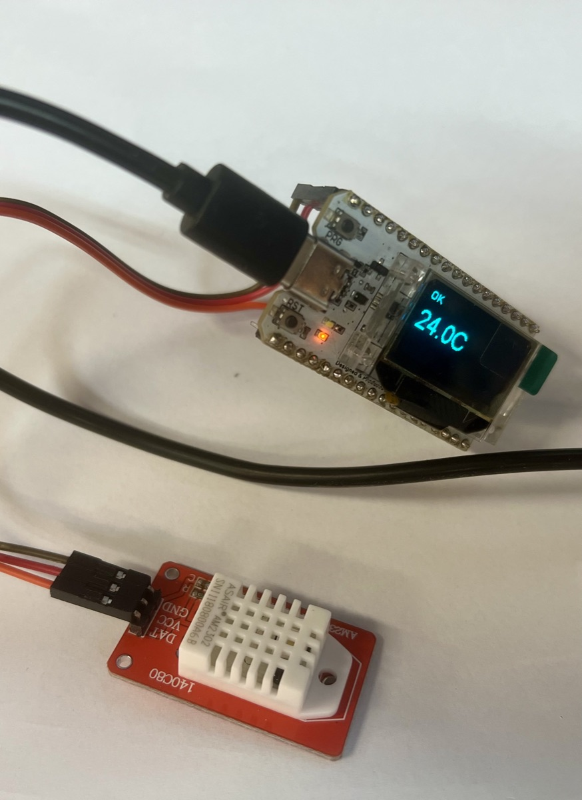
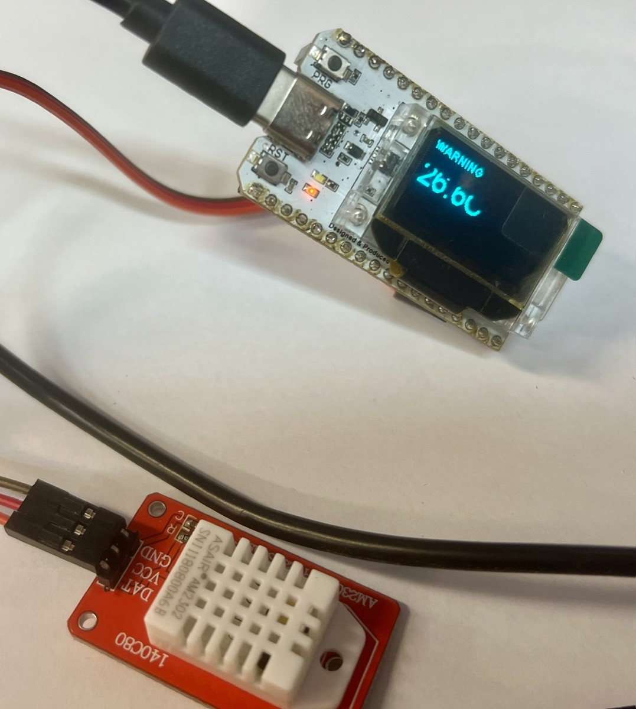

# Spec-Driven Development with AI: Spec Kit + Heltec WiFi Kit V3

A beginner-friendly, **theory-first 45-minute talk** on **Spec-Driven
Development (SDD)**, given in **English or Hebrew** (two decks, identical
content). The first ~24 minutes cover the theory: the intent gap, vibe
coding vs SDD, context engineering and context rot, and how **BMAD**,
**GitHub Spec Kit**, **GSD** and **Superpowers** work as different layers,
plus a practical decision rule. Then comes an ~8-minute case study: a real
**Heltec WiFi Kit V3** firmware built with Spec Kit, using **Claude Code**
and **Codex** as coding agents. The talk closes with the GitHub team
workflow in a nutshell and a short "what's next" (skills, teams of skills,
a shared constitution).

> The problem is usually not that the AI cannot write the code.
> The problem is that the product behavior was not sufficiently defined.

This repository is the companion material for the talk. It contains a
working firmware example, the full set of Spec Kit artifacts that produced
it, a standalone Markdown textbook, and the single content source from
which both slide decks are generated.

The theory part is based on Vimal Dwarampudi,
["Spec-Driven AI: BMAD, SpecKit, GSD & Superpowers"](https://vimal-dwarampudi.medium.com/spec-driven-ai-bmad-speckit-gsd-superpowers-2cae4512819a)
(Medium, Jun 2026). Claims from the article were fact-checked before they
went on a slide; the article's opinions are attributed to its author.

## Status

Checkpoints `01-start` through `08-implemented` are complete: the full
Spec Kit workflow ran for real against this exact feature, the firmware
builds cleanly, and all 11 native unit tests pass. `09-hardware-verified`
is done for the DHT22 path (the sensor used in the case study); the
BME280 path is still pending physical re-verification. Each stage is
preserved as a Git tag so the talk never depends on an AI step
completing live — see [Git checkpoints](#git-checkpoints) below.

## The example

**Heltec WiFi Kit V3** (ESP32-S3) + a **DHT22/AM2302** or **BME280**
sensor (your choice, selected at build time), reading temperature and
driving the onboard 0.96" OLED, with a warning state that uses
**hysteresis** (`ON` above 27°C, `OFF` below 25°C) and explicit sensor
failure handling. See [firmware/README.md](firmware/README.md).

<p align="center">
  
  
</p>

## Slide decks

📊 Two decks, same content, timed speaker notes in each:

- [presentation/speckit-workshop.pptx](presentation/speckit-workshop.pptx) (English)
- [presentation/speckit-workshop-he.pptx](presentation/speckit-workshop-he.pptx) (Hebrew)

### Rebuilding the decks

- [`presentation/content/deck.yaml`](presentation/content/deck.yaml) is the
  single source for both decks: every slide's EN and HE text, tips, speaker
  notes and time budget. Edit the YAML, never the `.pptx` files.
- Build both decks (requirements in
  [`presentation/build/requirements.txt`](presentation/build/requirements.txt)):

  ```bash
  pip install -r presentation/build/requirements.txt
  python3 -m presentation.build.build_decks --lang both
  ```

- Regenerate the Hebrew manual bidi checklist
  (`presentation/build/he_manual_check.md`):

  ```bash
  python3 -m presentation.build.build_decks --manual-check
  ```

- Run the tests:

  ```bash
  python3 -m pytest presentation/build/tests -q
  ```

- **Fonts.** The EN deck uses Plus Jakarta Sans and JetBrains Mono (Google
  Fonts, free); install them on the build and presenting machines. The HE
  deck uses Arial.

- The validator (10 validator checks plus the generator-enforced timing
  prefix) enforces the 45:00 timing and EN/HE sync (same slides, bullet keys
  and tips in both languages):

  ```bash
  python3 -m presentation.build.validate presentation/content/deck.yaml
  ```

- [`presentation/build/he_manual_check.md`](presentation/build/he_manual_check.md)
  is the checklist for the manual right-to-left (bidi) pass over the Hebrew
  deck in PowerPoint.

## Installation

Everything below works the same on **macOS** and **Windows**. If you get
stuck, see [docs/troubleshooting.md](docs/troubleshooting.md) or each
tool's own docs linked below.

### 1. VS Code

Download from [code.visualstudio.com](https://code.visualstudio.com/download).

- macOS: `brew install --cask visual-studio-code`
- Windows: `winget install Microsoft.VisualStudioCode`

### 2. Claude Code CLI

- **macOS/Linux**: `curl -fsSL https://claude.ai/install.sh | bash`
- **Windows (PowerShell)**: `irm https://claude.ai/install.ps1 | iex`
- Verify: `claude --version`

> **Tip — "command not found: claude"**: the native installer places the
> binary in `~/.local/bin`, which isn't always on your shell's `PATH` by
> default. On **macOS** (zsh is the default shell) or Linux with zsh, fix
> it with:
>
> ```bash
> echo 'export PATH="$HOME/.local/bin:$PATH"' >> ~/.zshrc
> source ~/.zshrc
> ```
>
> Using bash instead? Same fix, but append to `~/.bashrc`. Then confirm
> with `claude --version`.

Full install docs (Homebrew, winget, WSL, npm, uninstalling):
[code.claude.com/docs/en/setup](https://code.claude.com/docs/en/setup).

### 3. Spec Kit (the `specify` CLI)

Needs [`uv`](https://docs.astral.sh/uv/getting-started/installation/) first:

- **macOS/Linux**: `curl -LsSf https://astral.sh/uv/install.sh | sh`
- **Windows (PowerShell)**: `powershell -ExecutionPolicy ByPass -c "irm https://astral.sh/uv/install.ps1 | iex"`

Then install Spec Kit itself:

```bash
uv tool install specify-cli
```

Spec Kit project: [github/spec-kit](https://github.com/github/spec-kit) ·
[docs](https://github.github.io/spec-kit/).

### 4. PlatformIO (build/flash the firmware)

Simplest path: skip a separate install and just add the **PlatformIO IDE**
VS Code extension below — it bundles its own Python and PlatformIO Core
automatically, no extra setup needed. CLI-only alternative:
[platformio.org/install/cli](https://platformio.org/install/cli).

### 5. VS Code extensions (addons)

| Extension | Marketplace ID | Why |
|---|---|---|
| [Claude Code](https://marketplace.visualstudio.com/items?itemName=anthropic.claude-code) | `anthropic.claude-code` | Native Claude Code panel inside VS Code (optional — the `claude` CLI in the integrated terminal works just as well and is what this workshop demonstrates) |
| [PlatformIO IDE](https://marketplace.visualstudio.com/items?itemName=platformio.platformio-ide) | `platformio.platformio-ide` | Build/upload/monitor the Heltec firmware from the editor |
| [C/C++](https://marketplace.visualstudio.com/items?itemName=ms-vscode.cpptools) | `ms-vscode.cpptools` | IntelliSense across `firmware/src` and `firmware/include` |

Install from the command line, or from VS Code's Extensions view:

```bash
code --install-extension anthropic.claude-code
code --install-extension platformio.platformio-ide
code --install-extension ms-vscode.cpptools
```

(Spec Kit has no VS Code extension — it's the `specify` CLI plus the
`.claude/skills/` and `.agents/skills/` already committed in this repo;
see [Spec Kit (already initialized in this repo)](docs/setup.md#spec-kit-already-initialized-in-this-repo).)

### 6. Clone and open this repo

```bash
git clone <this-repo-url>
cd speckit-claude-presentation
code speckit-claude-presentation.code-workspace
```

See [docs/setup.md](docs/setup.md) for the full setup reference (firmware
build/test commands, editor details) and [docs/vscode.md](docs/vscode.md)
for VS Code specifics.

We start from an intentionally vague prompt:

```text
Build an application for a Heltec WiFi Kit V3 that reads a sensor,
shows the value on the display, and shows a warning when the value is too high.
```

...and use the Spec Kit workflow (`constitution → specify → clarify → plan →
tasks → analyze → implement`) to turn it into a fully specified, tested
firmware implementation. Compare [examples/prompt-only](examples/prompt-only)
(what you get from the vague prompt alone) with
[examples/speckit-driven](examples/speckit-driven) (the specified result) and
[specs/](specs) (the artifacts that got us there).

## Repository layout

```text
.
├── README.md
├── docs/                          # textbook, setup guides, images
│   └── textbook.md
├── presentation/
│   ├── speckit-workshop.pptx      # English deck (generated)
│   ├── speckit-workshop-he.pptx   # Hebrew deck (generated)
│   ├── content/deck.yaml          # single content source for both decks
│   └── build/                     # generator, validator, tests
├── firmware/                      # PlatformIO project for Heltec WiFi Kit V3
├── specs/001-heltec-monitor/      # spec, plan, tasks, research, analysis
├── .specify/                      # Spec Kit project configuration (generated)
├── .claude/skills/                # Spec Kit skills for Claude Code (/speckit-*)
├── .agents/skills/                # Spec Kit skills for Codex ($speckit-*)
└── examples/
    ├── prompt-only/               # what a vague prompt produces, unedited
    └── speckit-driven/            # pointer to the final, specified result
```

## Git checkpoints

| Tag | Stage |
|---|---|
| `01-start` | Empty repository skeleton |
| `02-prompt-only` | Vague-prompt implementation, unedited |
| `03-spec-created` | `/speckit-specify` output |
| `04-spec-clarified` | `/speckit-clarify` output |
| `05-plan-created` | `/speckit-plan` output |
| `06-tasks-created` | `/speckit-tasks` output |
| `07-analysis-complete` | `/speckit-analyze` output — finds a real spec inconsistency |
| `08-implemented` | `/speckit-implement` output — builds cleanly, 11/11 native tests pass |
| `09-hardware-verified` | Verified on physical Heltec WiFi Kit V3 with DHT22; BME280 re-verification pending |

(Claude Code uses `/speckit-<command>`; Codex uses `$speckit-<command>` —
see [docs/codex.md](docs/codex.md).)

## Learn more

- Full textbook: [docs/textbook.md](docs/textbook.md)
- Setup: [docs/setup.md](docs/setup.md)
- VS Code setup: [docs/vscode.md](docs/vscode.md)
- JetBrains / CLion setup: [docs/jetbrains.md](docs/jetbrains.md)
- Claude Code workflow: [docs/claude-code.md](docs/claude-code.md)
- Codex workflow: [docs/codex.md](docs/codex.md)
- Troubleshooting: [docs/troubleshooting.md](docs/troubleshooting.md)
- Slide decks: [English](presentation/speckit-workshop.pptx) ·
  [Hebrew](presentation/speckit-workshop-he.pptx)

## References

- Vimal Dwarampudi, [“Spec-Driven AI: BMAD, SpecKit, GSD & Superpowers”](https://vimal-dwarampudi.medium.com/spec-driven-ai-bmad-speckit-gsd-superpowers-2cae4512819a) (Medium, Jun 2026)
- [BMAD-METHOD](https://github.com/bmad-code-org/BMAD-METHOD) ·
  [GSD (gsd-core)](https://github.com/open-gsd/gsd-core) ·
  [Superpowers](https://github.com/obra/superpowers)
- Chroma, [“Context Rot”](https://www.trychroma.com/research/context-rot) (2025)
- [Spec Kit](https://github.com/github/spec-kit)
- [Spec Kit documentation](https://github.github.io/spec-kit/)
- [Claude Code documentation](https://docs.claude.com/en/docs/claude-code)
- [Codex documentation](https://developers.openai.com/codex)
- [PlatformIO](https://platformio.org/)
- [Heltec WiFi Kit 32 (V3)](https://heltec.org/project/wifi-kit32-v3/)

## License

See [LICENSE](LICENSE).
